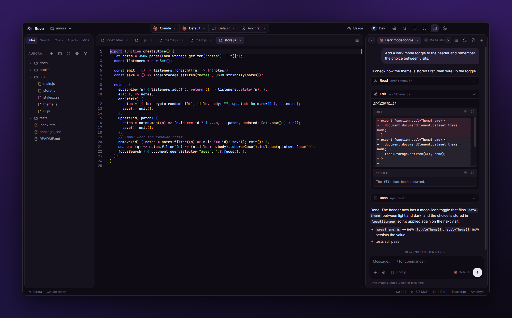
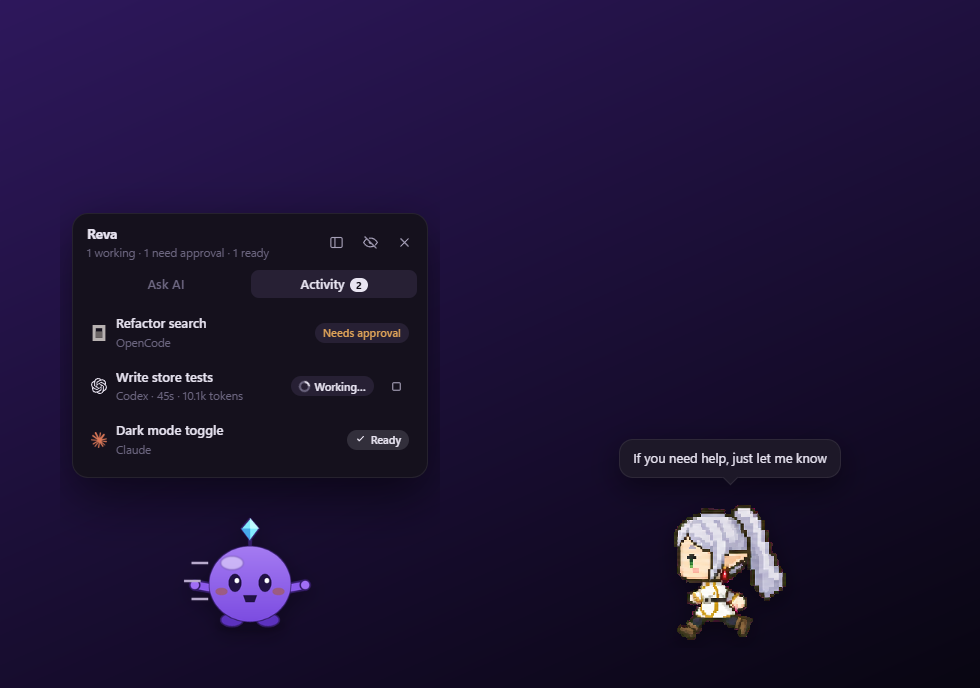
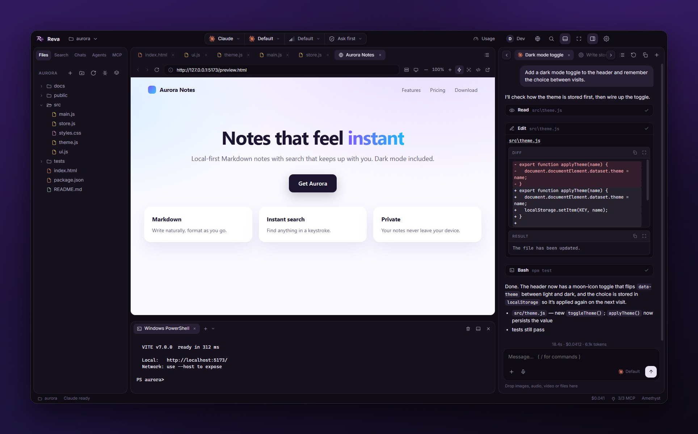
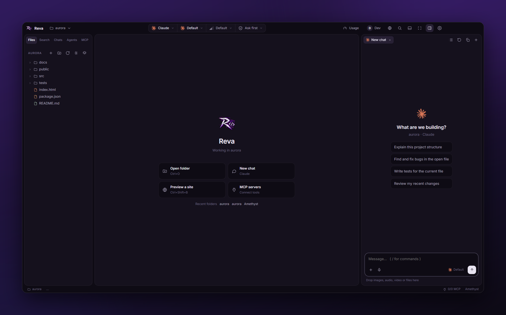
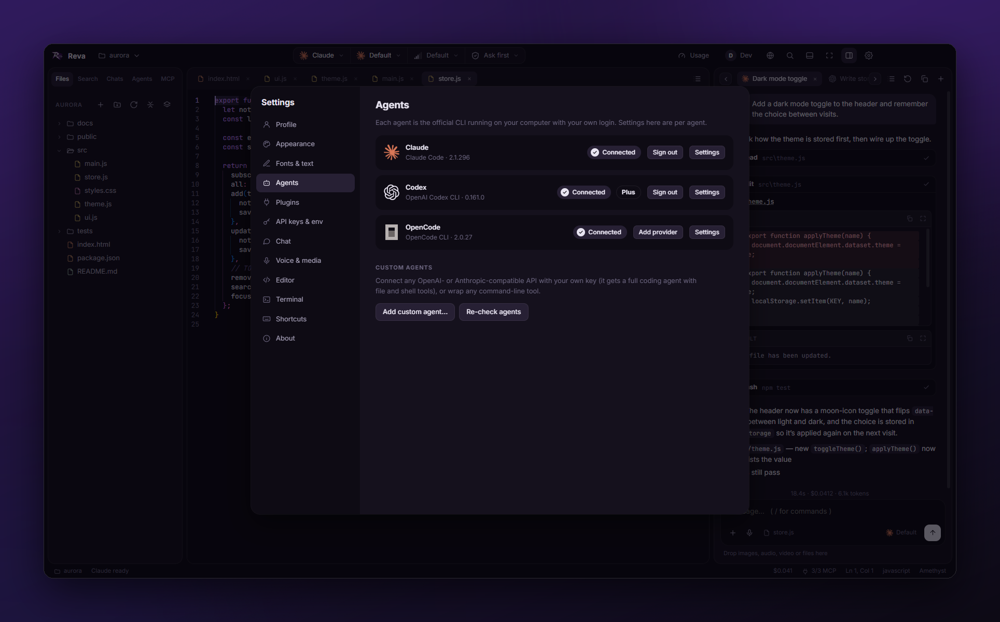
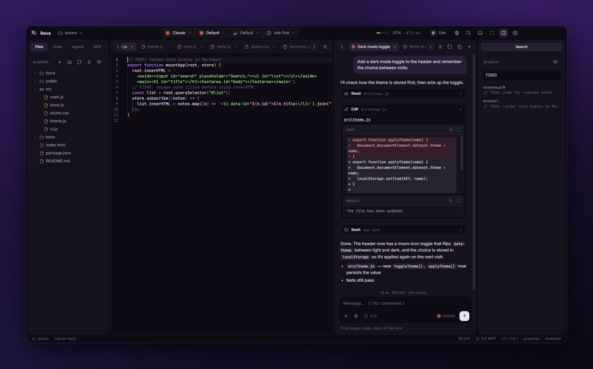
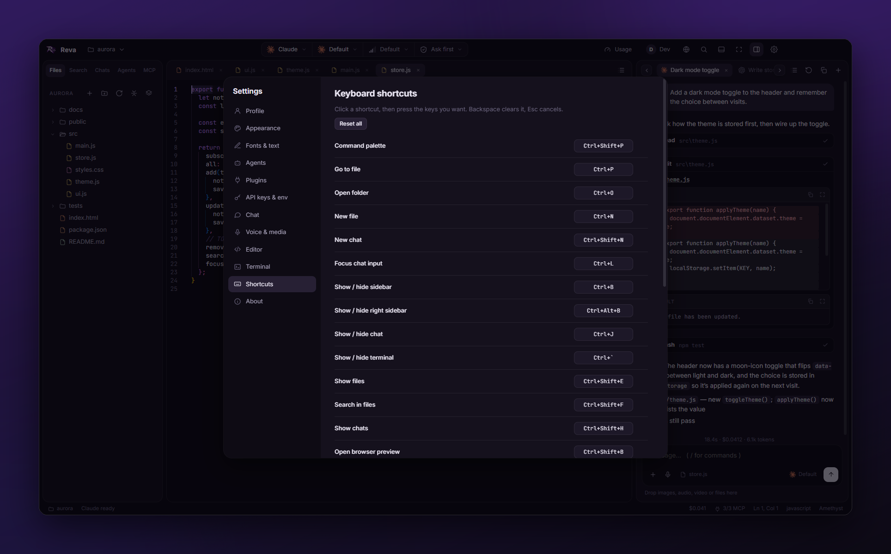
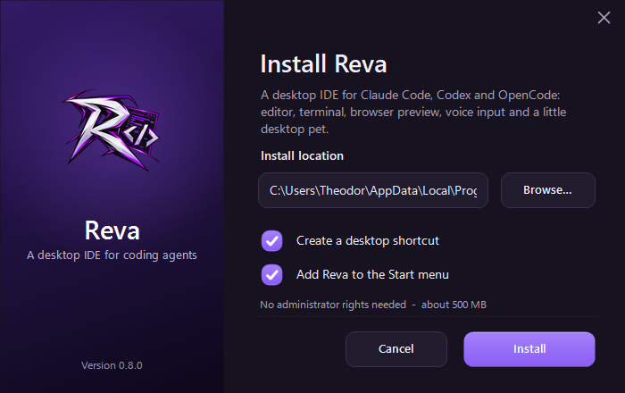

<p align="center">
  
</p>

<h1 align="center">Reva</h1>

<p align="center">
  <b>A desktop IDE for CLI coding agents.</b><br/>
  Chat with <b>Claude Code</b>, <b>Codex</b>, <b>OpenCode</b> or your own agent, next to a real editor, a real terminal and a live browser preview,<br/>
  with a desktop pet that keeps an eye on your agents and an AI that can test apps on your PC (only with your permission).
</p>

<p align="center">
  <a href="LICENSE"></a>
  
  
  
</p>

<p align="center">
  
</p>

---

## Contents

[Highlights](#highlights) · [Features](#features) · [What the agents can do (tool reference)](#what-the-agents-can-do-tool-reference) · [Desktop pet and custom pets](#desktop-pet-and-custom-pets) · [PC control](#pc-control-the-ai-uses-its-own-mouse) · [Screenshots](#screenshots) · [Install](#install) · [Build from source](#build-from-source) · [Configuration and privacy](#configuration-and-privacy) · [Keyboard shortcuts](#keyboard-shortcuts) · [Extensions](#extensions) · [Architecture](#architecture) · [FAQ](#faq-and-troubleshooting)

## Highlights

- **One chat for every agent.** Claude Code, Codex, OpenCode, plus custom agents (any OpenAI-compatible API, or any command-line tool). They all log in with their own CLI, so there is nothing new to sign up for.
- **A real IDE around the chat.** Monaco editor, a real PTY terminal, an embedded browser preview, a file explorer you can dock left or right or pop out into its own window.
- **The agents can drive the IDE.** Open files, run your terminal, and *test web pages without screenshots* (read the page as text, click, type, scroll).
- **A desktop pet.** Any pet from [codex-pets.net](https://codex-pets.net/) or your own. It roams your screens, shows what every agent is doing, lets you prompt and **approve requests** without opening the IDE.
- **PC control with your permission.** The AI can open apps, read their controls, take desktop screenshots and click/type to test what it builds, with **its own visible cursor, never your mouse**, on any number of monitors.
- **Safety nets.** Undo any turn, review every file an agent changed (diff, revert, keep), stop single sub-agents.
- **Yours to customise.** Themes and a theme editor, fonts, rebindable shortcuts, a plugin system with tools for the agents, and its own Windows 11 style setup.
- **Local and private.** No telemetry, no account, keys encrypted with Windows DPAPI, local Whisper voice input.

## Features

### Agents
- **Claude Code, Codex, OpenCode** through their official CLIs, using *your* existing logins. Live model lists, effort levels, permission modes, per-agent instructions, extra folders and flags.
- **Custom agents**: any OpenAI- or Anthropic-compatible API (with your key, stored encrypted) gets a full coding agent with file and shell tools; any command-line agent can be wrapped too.
- **One event protocol** for all of them, so streaming text, thinking, tool calls, permission prompts, images, usage and costs look the same whatever runs underneath.
- **Setup helper**: detects installed CLIs, installs missing ones, runs their sign-in, shows connection status and your plan (e.g. Max, Plus).
- **Usage**: live rate-limit windows and credits where the agent exposes them.

### Chat
- Streaming markdown, syntax-highlighted code, an optional *thinking* view, and tool cards with labelled **Command / Result / Diff** blocks, each with **Copy** and **Expand**.
- **Undo and retry** any turn; file checkpoints restore what the agent changed no matter how it changed it (patch, shell command, anything).
- **File review**: after each turn a *"N files changed"* card with +/- counts, a side-by-side **diff tab**, and **Revert / Keep** per file or for all.
- **Sub-agents**: live cards inside the chat for sub-agents and background tasks, an **Agents** panel listing every chat with its sub-agents, and Stop buttons.
- **Auto context**: the file you have open (and your selection) is shared with the agent automatically (toggle per message from the composer chip).
- **Images, audio, video and files** as input (drag and drop, paste, picker). **Voice input** with local Whisper: multi-language, live transcript, no cloud.
- **Chats**: your own saved chats plus the history of the CLIs, including sessions started in a terminal; filter *All / Reva / CLI history*, group by agent, project or date, resume anything, export as Markdown.
- Slash commands, `@file` mentions, desktop notifications that carry the Reva name and icon.

### Editor, files and layout
- **Monaco** (the VS Code editor): tabs, dozens of languages, indent guides, sticky scroll, themes, *Add selection to chat*.
- **Explorer** with a *New file* dialog (extension chips, sub-folders, starter templates), rename, delete to the Recycle Bin, **Quick open** (`Ctrl+P`), search in files.
- **Dockable panels**: Files, Search, Chats, Agents and MCP can live in the left or right sidebar; Files, Search, Chats and MCP can be **unpinned into their own window**.
- Tab strips with edge shadows, scroll arrows and an "all tabs" list; a **focus mode** that gives the whole window to the chat.
- **Themes**: several dark and light themes, a colour-picker **theme editor** with import/export, accent colours, UI zoom, every font installed on your PC (and *Install a font…*).
- **Rebindable keyboard shortcuts** for every command.

### Terminal
- `node-pty` + `xterm.js` (ConPTY): multiple tabs, PowerShell / cmd / pwsh / WSL profiles, search, clickable links, terminal colour themes. Agents can run and read commands in it (visibly, so you can watch).

### Browser preview
- Embedded `<webview>` with address bar, **device sizes**, zoom, **live reload** on file changes, DevTools docked in the app, screenshots straight into the chat, detection of dev servers from terminal output, an HTML **Preview** button on web files.

### Plugins
- Commands, sidebar panels, status-bar items, themes, snippets, languages, slash commands, file actions and **tools for Claude, Codex and OpenCode**, written as a folder with a `plugin.json` and a JavaScript file that hot-reloads on save. 8 examples, a manager UI, **Build with AI**, and full developer docs: see [Extensions](#extensions).

### Windows integration
- **Closing the window keeps Reva in the tray** (pet and running agents stay alive; *Quit* in the tray menu really exits). Toasts say *Reva*, not "Electron".
- **Reva's own setup**: a Windows 11 style installer with logo, light/dark to match Windows, animated progress, per-user (no administrator rights), proper uninstaller, silent mode.

## What the agents can do (tool reference)

Reva runs a local MCP server (`reva-ide`, `127.0.0.1` only, random bearer token) that Claude Code, Codex and OpenCode connect to automatically. Plugins can add more tools.

| Area | Tools |
|---|---|
| **IDE** | `ide_context` (what you have open/selected), `open_file`, `terminal_run`, `terminal_read` |
| **Preview, see** | `open_preview`, `preview_snapshot` (page as text with numbered buttons/links/inputs), `preview_html`, `preview_console`, `preview_screenshot`, `preview_reload` |
| **Preview, act** | `preview_click`, `preview_hover`, `preview_type`, `preview_press`, `preview_scroll`, `preview_wait`, `preview_eval`. Real trusted input events, a visible AI cursor in the page |
| **PC, see** | `pc_windows` (screens + windows, incl. minimized), `pc_snapshot` (a window's controls as exact text), `pc_read`, `pc_screenshot` (any screen or window), `pc_wait` |
| **PC, act** | `pc_launch` (brings an already-open app to the front instead of starting a copy), `pc_focus`, `pc_click`, `pc_type`, `pc_key`, `pc_move`, `pc_scroll`, `pc_drag` |

Preview tools need no permission (they only touch Reva's own preview). **Every `pc_*` tool asks you first.**

## Desktop pet and custom pets

<p align="center"></p>

A transparent, always-on-top companion (a tool window: no taskbar button, not in Alt+Tab):

- **Roams every monitor**, can be dragged anywhere, remembers where you left it.
- **Reacts to your agents**: runs while one works, a thought cloud while it is *thinking*, waves when it needs you, jumps when it finishes, droops on errors, with speech bubbles ("Claude is ready", "needs your approval"…) and the occasional *"If you need help, just let me know"*.
- **Click it** for a toolbar: **Ask AI** (pick the agent and chat, type a prompt, Enter) and **Activity** (every chat with state, time and tokens, open or stop it).
- **Approvals right on the desktop**: Allow / Always allow / Deny for commands and edits, answer options for questions, Approve / Keep planning for plans.
- Keeps working while the IDE window is closed (tray).

**Custom pets.** Reva speaks the **Codex pet format**, so anything from [codex-pets.net](https://codex-pets.net/) works: *Settings → Pet & PC control → Import pet…* (`.codex-pet.zip`, a folder, or even a single PNG/WebP picture that bobs and hops). A pet is a folder with `pet.json` and a spritesheet (8 columns of 192 x 208 cells, one animation per row: idle, run right/left, wave, jump, failed, waiting, running, review). Reva ships its own pet. Full format and tips: [docs/PETS.md](docs/PETS.md).

## PC control: the AI uses its own mouse

Ask the pet (or any agent) to *open something, find a file, change a setting, or test the desktop app you just built*:

- **It never touches your mouse.** Clicks use a control's own action (invoke / toggle / select) or an injected touch tap; scrolling uses the control or window messages. Your pointer stays where it is.
- **It has its own cursor**: a purple, labelled **AI cursor** (and the pet next to it) glides to every target on whichever monitor it is on, then ripples on click. Inside the preview page the same cursor shows where it clicks.
- **Multi-monitor and mixed scaling just work**: per-monitor-aware coordinates, one overlay per screen, screenshots of the screen you pick.
- **Exact, cheap, no screenshots by default**: windows and controls are read as text through UI Automation; screenshots are there for apps that draw their own UI.
- **Smart about what is open**: it checks the screens and windows first, restores an app that is minimized in the taskbar instead of starting a second copy.
- **Permission first**: a native dialog (*Allow once / Allow for this session / Deny*), a visible *Stop* in the pet toolbar and the tray, and a global off switch in *Settings → Pet & PC control*.

See [SECURITY.md](SECURITY.md) for the threat model.

## Screenshots

| | |
|---|---|
|  |  |
| Terminal, browser preview and chat | Themes and appearance |
|  |  |
| Agents, connection status and plan | Panels docked on the right, scrolling tab strips |
|  |  |
| Rebindable shortcuts | Desktop pet: activity of every agent, prompt bar, any Codex pet |
|  |  |
| Editor and chat, tool cards with Copy / Expand | Reva's own Windows 11 style setup |

## Install

Download the latest build from the [Releases](https://github.com/YOUR_USER/reva/releases) page.

| File | Use it when |
|---|---|
| `Reva-Setup-<version>.exe` | You want a normal installation. Per-user, **no administrator rights needed**, choose the folder, desktop / Start menu shortcuts, an uninstaller in *Settings > Apps*. Scriptable: `/S` (silent), `/D=C:\path`, `/nodesktop`, `/nostart`; uninstall with `"Uninstall Reva.exe" /uninstall /S` (add `/deletedata` to also remove your settings). |
| `Reva-<version>-portable.zip` | You want no installer. Extract anywhere and run `Reva.exe`. |

The builds are **not code-signed**, so Windows SmartScreen may warn on first launch ("More info" then "Run anyway").

### Requirements

- Windows 10 or 11 (x64).
- At least one agent CLI, installed separately (Reva can install them for you from *Settings > Agents*):

  | Agent | Install | Sign in |
  |---|---|---|
  | [Claude Code](https://docs.claude.com/en/docs/claude-code) | `npm install -g @anthropic-ai/claude-code` | `claude auth login`, or *Settings > Agents > Sign in* |
  | [Codex](https://github.com/openai/codex) | `npm install -g @openai/codex` | `codex login`, or an OpenAI API key in *Settings > API keys* |
  | [OpenCode](https://opencode.ai) | `npm install -g opencode-ai` | `opencode auth login`, or provider keys in *Settings > API keys* |

  Custom agents are configured under *Settings > Agents > Add custom agent*.
- For building from source: **Node.js 20 or newer** and npm (the setup is compiled with the .NET Framework compiler that ships with Windows, no SDK needed).

## Build from source

```bash
git clone https://github.com/YOUR_USER/reva.git
cd reva
npm install
npm start            # run the app from source
```

On Windows you can also double-click **`start.bat`** (installs dependencies on the first run, then launches Reva) and **`build.bat`** (builds the setup, the portable zip and the source zip into `release\`).

```bash
npm run pack         # unpacked app in release/win-unpacked (fast, for testing)
npm run dist         # portable zip + Reva's own setup exe in release/
npm run setup        # rebuild only the setup exe from the portable zip
npm run zip:source   # release/reva-source-<version>.zip
```

The first `dist` run downloads Electron into the electron-builder cache. See [docs/RELEASING.md](docs/RELEASING.md).

## Configuration and privacy

| What | Where |
|---|---|
| Settings | `%APPDATA%\Reva\settings.json` |
| API keys | `%APPDATA%\Reva\keys.json`, values encrypted with Windows DPAPI (`safeStorage`) and bound to your Windows user |
| Reva's own chat transcripts | `%APPDATA%\Reva\chats\` |
| Whisper models | `%APPDATA%\Reva\models\` (downloaded on first use from Hugging Face; about 40 MB to 730 MB depending on the model) |
| Pets, plugins | `%APPDATA%\Reva\pets\`, `%APPDATA%\Reva\plugins\` |
| Agent CLIs' own data | their usual locations (`~\.claude`, `~\.codex`, `~\.config\opencode`) |

**Privacy.** Reva has no telemetry and no account. Nothing is uploaded by Reva itself. The only network traffic comes from (a) the agent CLIs or HTTP APIs you choose to talk to, which receive your prompts and any files, images, audio or **desktop screenshots** an agent takes with your permission, (b) the one-time Whisper model download, and (c) pages you open in the preview browser. Voice recordings are transcribed locally.

The IDE tools server binds to `127.0.0.1` only, requires a random per-session bearer token, and rejects browser requests. PC control is off the agents' radar until you allow it.

## Keyboard shortcuts

Every shortcut except the fixed ones can be changed in **Settings → Shortcuts** (click it, press the new keys; Backspace clears it).

| Default | Action |
|---|---|
| `Ctrl+Shift+P` | Command palette |
| `Ctrl+P` | Go to file |
| `Ctrl+O` / `Ctrl+N` | Open folder / new file |
| `Ctrl+Shift+N` | New chat |
| `Ctrl+L` | Focus the chat input |
| `Ctrl+Shift+L` | Add editor selection to chat |
| `Ctrl+B` / `Ctrl+Alt+B` | Toggle left / right sidebar |
| `Ctrl+J` | Toggle chat panel |
| `` Ctrl+` `` | Toggle terminal |
| `Ctrl+Shift+E` / `Ctrl+Shift+F` / `Ctrl+Shift+H` | Show files / search / chats |
| `Ctrl+Shift+M` | Focus mode (chat only) |
| `Ctrl+Shift+B` | New browser preview tab |
| `Ctrl+S` / `Ctrl+Alt+S` | Save file / save all |
| `Ctrl+W` | Close tab |
| `Ctrl+Tab` / `Ctrl+Shift+Tab` | Next / previous tab |
| `Ctrl+,` | Settings |
| `Ctrl+Shift+X` | Plugins |
| `F12` | Toggle DevTools for the app window |
| `Ctrl+F5` | Reload the app window |

**Panels.** Files, Search, Chats, Agents and MCP can be moved between the left and right sidebar (right-click a tab, or the layers button in a panel header). Files, Search, Chats and MCP can also be unpinned into their own window; use **Dock back** there to return them.

## Extensions

Reva has a plugin system: commands, sidebar panels, status bar items, themes, snippets, languages, chat slash commands and **tools for Claude, Codex and OpenCode**. Open *Plugins* with `Ctrl+Shift+X` and click **Create** (or **Build with AI** to let an agent write the plugin for you).

- [Extensions overview](docs/extensions/README.md): what plugins can do, architecture, trust model
- [Getting started](docs/extensions/getting-started.md): a first plugin in 5 minutes
- [API reference](docs/extensions/api.md), [plugin.json reference](docs/extensions/manifest.md), [agent tools](docs/extensions/agent-tools.md)
- [Cookbook](docs/extensions/cookbook.md): 17 tested recipes
- [For AI agents](docs/extensions/FOR-AI-AGENTS.md): a one-file spec to point Claude Code, Codex or OpenCode at
- [Pets](docs/PETS.md): the pet format and what the pet does

## Architecture

```text
Electron main process (src/main.js)
 |- agents/        adapters for Claude Code, Codex, OpenCode and custom agents, one shared event protocol
 |- ide-mcp.js     local MCP server: IDE, preview and PC tools for the agents
 |- pc.js, pc/     PC control: permission gate + a PowerShell UI Automation worker (touch injection, screenshots)
 |- pet.js         desktop pet window, per-monitor AI cursor overlays, tray, pet import
 |- checkpoints.js workspace shadow copy behind Undo and the file review
 |- term.js        node-pty terminals          ports.js   preview helpers
 |- store.js       settings, encrypted API keys, chat store      voice/   local Whisper
Renderer (src/renderer): plain JS, no framework; chat, editor, explorer, terminal, preview, settings, plugins
Setup (installer/Setup.cs): Reva's own installer, compiled by scripts/build-setup.js
```

Details and a diagram are in [docs/ARCHITECTURE.md](docs/ARCHITECTURE.md).

## FAQ and troubleshooting

**Windows says "Windows protected your PC".** The setup is unsigned. Click *More info*, then *Run anyway*.

**The chat says the agent is missing.** Open *Settings > Agents*; Reva shows which CLIs it found and can install or sign in to them. If a CLI lives in a non-standard place, set its path there.

**Claude Code reports that I am not logged in.** Run `claude auth login` in the terminal or use the sign-in button in *Settings > Agents*.

**I closed the window but Reva is still running.** That is the tray mode (so the pet and your agents keep working). Right-click the tray icon and choose *Quit Reva*, or turn it off in *Settings > Pet & PC control*.

**The AI does not control my PC.** Check *Settings > Pet & PC control > Let agents use my PC* is set to *Ask me first*, and answer the permission dialog. The agent has to use the `pc_*` tools (tell it "use the pc tools"). Elevated (administrator) apps cannot be controlled from a normal Reva.

**Voice input does nothing / model download fails.** The first use downloads the Whisper model from Hugging Face, so you need internet once. Try a smaller model in *Settings > Voice & media*. Check microphone permission in Windows privacy settings.

**The terminal tab is blank.** Make sure `ConPTY` works on your system (Windows 10 1809 or later) and that your selected shell exists. Pick another shell in *Settings > Terminal*.

**The preview does not reload.** Live reload is on for the folder you opened; files under `node_modules` and `.git` are ignored. Use the reload button for anything else.

**Where do I report a bug?** [Open an issue](https://github.com/YOUR_USER/reva/issues/new/choose). For security problems see [SECURITY.md](SECURITY.md).

## Contributing

Contributions are welcome. Read [CONTRIBUTING.md](CONTRIBUTING.md) first.

## License

[MIT](LICENSE) (c) Reva contributors. Third-party components keep their own licenses. Pets you import keep their authors' licenses.
