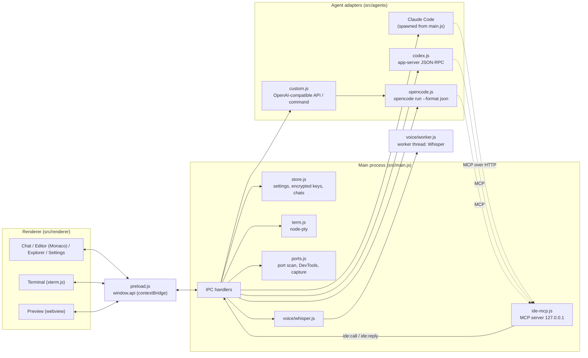

# Architecture

Reva is an Electron app with a plain-JavaScript renderer (no bundler, no framework).

## Main process

- `main.js` creates the window, registers IPC handlers (file system, dialogs, MCP management for Claude Code, providers, usage, voice) and starts agents (`agent:start`). The window is frameless with a custom overlay title bar.
- `store.js` persists `settings.json`, the encrypted `keys.json`, and Reva's own chat transcripts; it also builds the environment passed to agents.
- `term.js` owns node-pty sessions (ConPTY) and streams data to the terminal tabs.
- `ports.js` supports the preview: scanning local ports, docking DevTools into the preview, capturing screenshots.
- `voice/` runs Whisper in a worker thread (`worker.js`) so transcription never blocks the main process. When packaged, the worker is loaded from `app.asar.unpacked`.

## Agent adapters

Each adapter starts a CLI or HTTP backend and translates its protocol into **one event protocol**: Claude-Code `stream-json` shaped events (`system/init`, `stream_event`, `assistant`, `user` tool results, `control_request` permission prompts, `result`, plus `usage_event` / `token_usage`). The renderer (`chat.js`) only understands that protocol, so adding a backend means writing an adapter, not touching the UI.

| Adapter | Backend |
|---|---|
| Claude Code | spawns `claude` with `--output-format stream-json` and bidirectional stdin control |
| `agents/codex.js` | `codex app-server` over JSON-RPC |
| `agents/opencode.js` | one `opencode run --format json` process per turn, JSON events translated |
| `agents/custom.js` | user-defined agents: OpenAI-compatible endpoints (routed through OpenCode with generated config) or a custom command |
| `agents/installer.js` | detects, installs and signs in to the CLIs |

## IDE tools MCP server

`ide-mcp.js` is an MCP server (Streamable HTTP, `POST /mcp`) bound to loopback with a per-session bearer token. Each agent is configured at start-up to connect to it. Tools: `ide_context`, `open_file`, `open_preview`, `preview_reload`, `preview_screenshot`, `preview_console`, `preview_html`, `preview_eval`, `terminal_run`, `terminal_read`. Calls are forwarded to the renderer (`ide:call` event, answered via `ide:reply`) which performs them against the live UI.

## Renderer

Scripts are loaded in order from `index.html`: `util.js` (globals, helpers), `themes.js`, `settings*.js`, `panels.js` (explorer, search, sessions, MCP), `chat.js`, `terminal.js`, `browser.js`, `media.js` (voice/attachments), `app.js` (layout, Monaco, commands). The only bridge to the main process is `window.api` from `preload.js`.

**PC control and the pet.** `src/pc.js` is the permission gate and tool layer for the `pc_*` agent tools; the work is done by a long-lived PowerShell helper (`src/pc/worker.ps1`: UI Automation, per-monitor-DPI aware, touch injection so the user's mouse is never used, GDI screenshots). `src/pet.js` owns the pet window, the tray, pet import and one transparent click-through **cursor overlay window per monitor** (`renderer/cursor.html`) that draws the purple AI cursor; coordinates travel as physical virtual-desktop pixels and are converted with `screen.screenToDipPoint`. `renderer/pet-bridge.js` (IDE side) and `renderer/pet.js` (pet window) exchange chat state, events and approvals over IPC. `installer/Setup.cs` is Reva's own installer (see RELEASING.md). `combo.js` (popover menus; clicking the opener again closes it), `tabscroll.js` (tab strips with edge shadows, arrows and an "all tabs" list), `keys.js` (rebindable shortcut registry; commands are registered in `app.js`).

**Docking and pop-out.** `panels.js` keeps each sidebar panel in the left sidebar, the right sidebar (`#sidebar2`) or a separate window (`A.settings.layout.dock`). A popped-out panel is the same `index.html` loaded as `index.html?pop=<panel>` (`popout.js`): it renders only that panel and forwards anything that needs the main window (open a file, start a chat) through `pop:call`; file-watcher events, the workspace and the theme are broadcast to pop-out windows from the main process (`src/main.js`, `pop:*` handlers).

## Packaging

electron-builder (config in `package.json`, key `build`) produces an asar. Native or spawn-able things are unpacked via `asarUnpack`: node-pty, onnxruntime-node, sharp, `@huggingface/transformers` and `src/voice`. See [RELEASING.md](RELEASING.md).

